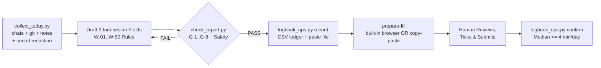

<div align="center">

# maganghub-logbook-ops

**Zero-dependency Indonesian daily logbook compiler, Delivery Gate, and compliance ledger for MagangHub Monev (Kemnaker).**

*Built with Python 3.9+ standard library only. Human-in-the-loop enforced: drafts & pre-fills, never auto-submits.*


</div>

---

## Why this exists

Missing a daily MagangHub Monev logbook risks stipend deductions, while rushing generic paragraphs causes mentor revisions or compliance mistakes. `maganghub-logbook-ops` combines:

1. **Evidence gathering (`skills/maganghub-logbook-ops/scripts/collect_today.py`)** from local agent chat logs, git commits, and manual notes—with automatic secret redaction and optional confidential-term flagging.
2. **Deterministic Delivery Gate (`skills/maganghub-logbook-ops/scripts/check_report.py`)** enforcing the 14 Indonesian writing rules (`W-xx` / `G-1`..`G-8`) plus credential and confidentiality checks.
3. **Compliance ledger & speed tracker (`skills/maganghub-logbook-ops/scripts/logbook_ops.py`)** adding raw-notes numeric grounding, 3-day Jaccard duplicate-drift detection, overwrite protection, paste-ready exports, and missed-workday / `<= 4` min/day median evaluation.
4. **Pre-publish privacy scanner (`scripts/leak_check.py`)** ensuring no credentials, local OS paths, PII, or confidential client terms enter public repositories.

> [!IMPORTANT]
> **Hard Human-in-the-Loop Guarantee**
> - This toolkit **never** ticks the confirmation checkbox and **never** clicks **Simpan dan Kirim** on MagangHub Monev.
> - This toolkit includes **zero** anti-bot, Cloudflare, or CAPTCHA bypasses and requires **zero** external browser extension relays.
> - Submitting daily reports also records attendance; the intern always reviews, checks, and submits manually.

## Install (1 Command)

Pick the command that matches your environment (`Python 3.9+` stdlib only):

- **Agent Skills CLI (Claude Code, Codex, Cursor, OpenCode, Antigravity, etc.):**

  ```bash
  npx skills add vanovri/maganghub-logbook-ops
  ```

- **macOS / Linux / WSL:**

  ```bash
  curl -fsSL https://raw.githubusercontent.com/vanovri/maganghub-logbook-ops/main/install.sh | bash
  ```

  *(Or from a local clone: `./install.sh`)*

- **Windows (PowerShell):**

  ```powershell
  irm https://raw.githubusercontent.com/vanovri/maganghub-logbook-ops/main/install.ps1 | iex
  ```

  *(Or from a local clone: `.\install.ps1`)*

- **Claude Code Plugin Marketplace:**

  ```text
  /plugin marketplace add vanovri/maganghub-logbook-ops
  /plugin install maganghub-logbook-ops@maganghub-logbook-ops
  ```

Invoke with `/maganghub-logbook-ops [notes]` inside your agent.

## Architecture



## Quickstart (Python 3.9+ stdlib only)

### 1. Collect today's work evidence

```bash
python skills/maganghub-logbook-ops/scripts/collect_today.py 2026-11-24 --notes "Review skema modul autentikasi dan perbaiki tes unit"
```

Pass `--sensitive-terms "ClientA,ProjectX"` to detect or `--redact-confidential` to mask confidential names before drafting.

### 2. Validate a draft with the Delivery Gate

Save `report.json` (`{"aktivitas": "- ...\n- ...\n- ...", "pelajaran": "...", "kendala": "..."}`):

```bash
python skills/maganghub-logbook-ops/scripts/check_report.py report.json --sensitive-terms "ClientA,ProjectX"
```

### 3. Record into your local CSV ledger & generate paste-ready export

```bash
python skills/maganghub-logbook-ops/scripts/logbook_ops.py --data-dir ./local-data record \
  --date 2026-11-24 \
  --json-input report.json \
  --raw-notes-file notes.txt \
  --sensitive-terms "ClientA,ProjectX"
```

This creates `./local-data/drafts/2026-11-24_report.txt` and updates `./local-data/logbook.csv` (kept out of git by `.gitignore`).

### 4. Prepare browser fill payload (optional) or copy-paste manually

```bash
python skills/maganghub-logbook-ops/scripts/logbook_ops.py --data-dir ./local-data prepare-fill --date 2026-11-24
```

Follow [`skills/maganghub-logbook-ops/references/form.md`](skills/maganghub-logbook-ops/references/form.md) using your agent's built-in browser tool (stopping strictly before the confirmation checkbox and **Simpan dan Kirim**), or paste directly from the generated draft file.

### 5. Confirm manual submission & track compliance status

```bash
python skills/maganghub-logbook-ops/scripts/logbook_ops.py --data-dir ./local-data confirm --date 2026-11-24 --actual-minutes 3.0 --revisions 0
python skills/maganghub-logbook-ops/scripts/logbook_ops.py --data-dir ./local-data status --start-date 2026-11-16
```

### 6. Run tests and privacy leak scan

```bash
python -m unittest discover -s tests -v
python scripts/leak_check.py . --blocklist "ClientA,ProjectX"
```

## Repository Layout

```text
├── .claude-plugin/
│   ├── marketplace.json        # Claude Code plugin marketplace manifest
│   └── plugin.json             # Claude Code plugin definition
├── .gitattributes
├── install.sh                  # 1-command macOS/Linux/WSL installer (local or curl | bash)
├── install.ps1                 # 1-command Windows PowerShell installer (local or irm | iex)
├── LICENSE
├── NOTICE.md
├── README.md
├── scripts/
│   └── leak_check.py           # Pre-publish PII, local-path, credential & blocklist scanner
├── skills/maganghub-logbook-ops/
│   ├── SKILL.md                # Agent skill workflow
│   ├── scripts/
│   │   ├── collect_today.py    # Evidence collector with secret & NDA redaction
│   │   ├── check_report.py     # 14-rule Delivery Gate (G-1..G-8) + safety checks
│   │   └── logbook_ops.py      # CSV ledger, drift/numeric checks, prepare-fill, metrics
│   └── references/
│       ├── writing-rules.md    # 14 W-xx Indonesian report writing rules
│       ├── form.md             # MagangHub Monev form labels, placeholders & safe fill flow
│       └── examples.md         # Compliant vs non-compliant Indonesian examples
└── tests/
    ├── test_logbook_ops.py     # Core unit, CLI & standalone skill tests
    └── test_public_hygiene.py  # Automated leak-check, layout & installer guardrails
```

## Attribution & License

Licensed under the [MIT License](LICENSE).
Writing rules (`W-01`..`W-50`), Delivery Gate checks (`G-1`..`G-8`), local evidence collection pattern, and verified MagangHub Monev portal mappings are adapted with attribution from [`raditsoic/maganghub-autofill`](https://github.com/raditsoic/maganghub-autofill) (MIT). See [NOTICE.md](NOTICE.md).
